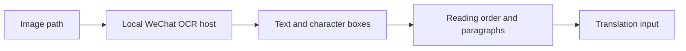

# WeChat OCR and translation investigation

## Local evidence

The machine contains WeChat OCR plugin 8096 at `C:\Users\laptop-jack\AppData\Roaming\Tencent\xwechat\XPlugin\Plugins\WeChatOcr\8096\extracted`. Inspection was limited to shared software/plugin assets; no chat database, account data, clipboard or private screenshot was read.

| Asset | Bytes | Interpretation |
| --- | ---: | --- |
| `wxocr.dll` | 24,486,952 | Version 1.0.0.134, valid Authenticode signature from Tencent Technology (Shenzhen) Company Limited |
| `text_det_fp16_v2.xnet` | 1,447,764 | Filename suggests text detection |
| `text_rec_zh13562_fp16_v2.xnet` | 8,354,384 | Filename suggests text recognition with a Chinese-oriented character set |
| `paragraph_det_fp16_v2.xnet` | 2,937,632 | Filename suggests paragraph/layout detection |

Those three model files total 12,739,780 bytes, approximately 12.15 MiB. Additional plugin assets include a character list, privacy detection, barcode models and other models. Their roles and network behavior were not dynamically verified. File names do not prove the neural architecture, precise tokenizer, execution precision or which stages are used for every request.

The searched running processes, common installation directories and uninstall registry entries did not identify an active WeChat host. Existing plugin files alone do not establish a working standalone runtime or disconnected OCR acceptance.

## Public calling implementation

The observed calling contract and plausible layout-aware processing stages are:

The public wrapper establishes the image-path request and returned text/geometry. Installed model names suggest detection, recognition and paragraph stages. Their exact invocation order and the current client's translation stage remain unverified.

[swigger/wechat-ocr](https://github.com/swigger/wechat-ocr), inspected at revision `e32d4af10d8045f8613078bac2df442662c76b03`, is a third-party calling demonstration, not a Tencent SDK or an open-source release of Tencent's OCR model.

Its [calling implementation](https://github.com/swigger/wechat-ocr/blob/e32d4af10d8045f8613078bac2df442662c76b03/src/wechatocr.cpp) starts the local host/component, submits an absolute image path using serialized Protobuf/MMMojo messages, and extracts recognized text, line rectangles, confidence and character boxes. The README documents separate 3.x executable and 4.x DLL interfaces. A 4.x DLL requires its compatible host/runtime; renaming a third-party wrapper does not make it Tencent's binary.

This supports a local component design. It is not evidence that no native network call occurs in every installed version. No Tencent component was executed or copied into the translation distribution, and no private interface was integrated into production. No redistribution license for the proprietary models was established.

## Translation research versus current product

The authors' [WeChat AI WMT21 paper](https://arxiv.org/abs/2108.02401) describes Transformer variants, data filtering, back-translation, knowledge distillation, domain adaptation and model ensembles. It is a 2021 competition system report. It does not identify the model or offline/online behavior of the user's current WeChat client.

The most relevant small-model lessons are to improve data/reference quality, train on domain correction contrasts, and evaluate held-out semantics. Deploying many large ensemble models would add memory and startup cost to a lightweight offline application. Teacher-generated targets require checking; none were generated by uploading user text in this task.

Tencent Cloud translation/OCR products and third-party WeChat OCR wrappers are not proof of the current WeChat client's translation architecture. Current client translation connectivity and its exact model remain unverified.

## Applicable product changes

The initial LightTranslate screenshot path flattened Windows OCR lines into independent paragraphs. Soft wraps lost a condition linking two lines. After the user's implementation request, version 1.0.3 retains Windows OCR word rectangles and reconstructs compatible paragraphs, list continuations and clear column order before local translation. This is an original geometry-based implementation inspired by the observed component structure; it does not reproduce Tencent's paragraph model. See `ocr-paragraph-reconstruction-2026-10-05.md` for actual comparison outputs and verification boundaries.

Prefer a documented, redistributable offline OCR implementation if a new engine is required. An optional adapter to the installed WeChat plugin would require version compatibility, host availability and a real no-network probe; it would not yield Tencent's trainable OCR or translation weights.
